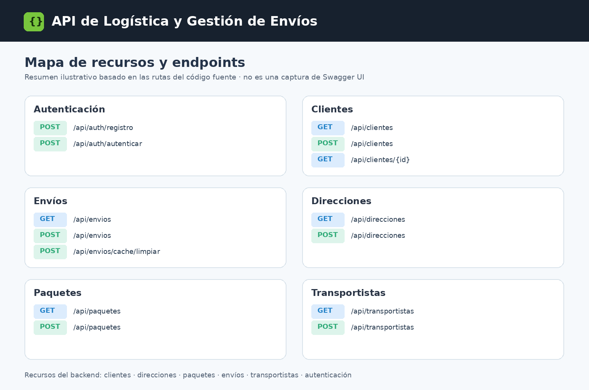
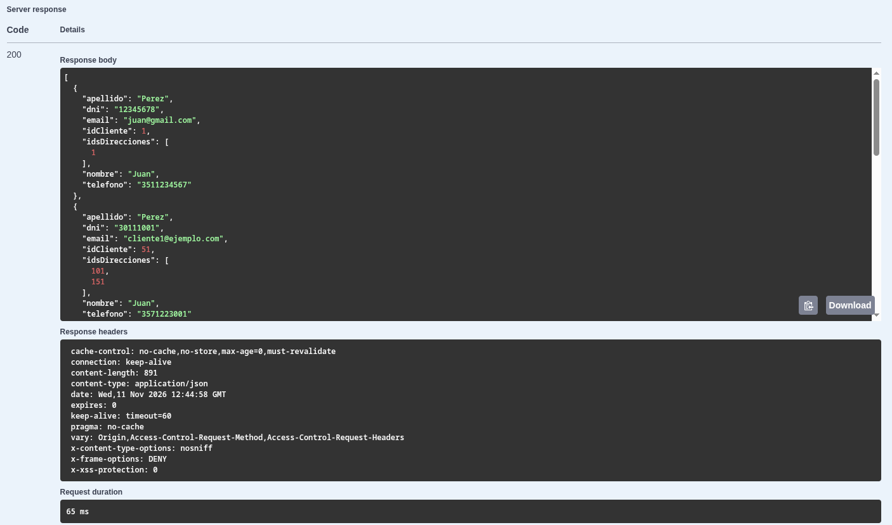

# API de Logística y Gestión de Envíos

API REST desarrollada con Java 21 y Spring Boot para administrar clientes, direcciones, transportistas, envíos y paquetes. Centraliza la información de las operaciones de logística, permite consultar los envíos y sus relaciones, y protege las operaciones mediante autenticación JWT.

El proyecto incluye validaciones de datos, documentación interactiva con OpenAPI/Swagger UI, una optimización de consultas para el listado de envíos, caché con invalidación y endpoints de monitoreo con Actuator.

> **Estado del proyecto:** backend funcional de demostración y portfolio. Puede ejecutarse localmente con PostgreSQL. **No está preparado para operar con datos reales en un entorno de producción sin los ajustes de seguridad y operación indicados en [Pendientes para producción](docs/PENDIENTES_PRODUCCION.md).** No incluye una interfaz frontend ni un despliegue público.

## Vista rápida del proyecto

El proyecto se ejecutó localmente y se documentó con Swagger UI. Las imágenes siguientes ayudan a visualizar sus recursos y una consulta realizada con datos de demostración; **no implican que la API esté desplegada públicamente**.

### Recursos disponibles

El siguiente esquema resume algunas de las rutas definidas en los controladores. **Es una ilustración generada a partir del código, no una captura real de Swagger UI.**



### Ejemplo de consulta a clientes

Respuesta HTTP **200** a una solicitud `GET /api/clientes` realizada desde Swagger UI, con un JSON de datos de prueba. La captura no contiene el token JWT.



## Funcionalidades

- Gestión de clientes, direcciones, transportistas, envíos y paquetes mediante endpoints REST.
- Asociación de clientes a direcciones y de envíos a sus respectivos clientes, ubicaciones, transportistas y paquetes.
- Consulta de envíos por identificador, por cliente y ordenados por fecha.
- Estados de envío: `PENDIENTE`, `EN_CAMINO` y `ENTREGADO`.
- Registro e inicio de sesión de usuarios con contraseñas almacenadas mediante BCrypt.
- Autenticación con JWT y autorización mediante las autoridades `USER` y `ADMIN`.
- Validación de solicitudes mediante Jakarta Validation y respuestas de error estructuradas.
- Listado de envíos optimizado con `@EntityGraph` para obtener los paquetes asociados evitando el patrón N+1 en esa consulta.
- Caché en memoria del listado de envíos mediante Spring Cache e invalidación al modificar envíos o paquetes.
- Endpoint administrativo para invalidar manualmente la caché de envíos.
- Configuración CORS para `http://localhost:3000`.
- Documentación generada automáticamente con SpringDoc OpenAPI y Swagger UI.
- Monitoreo con Spring Boot Actuator (`health`, `info` y `metrics`), restringido a `ADMIN`.

## Tecnologías

| Componente | Tecnología |
| --- | --- |
| Lenguaje y entorno | Java 21, Spring Boot 4.1.1 |
| Construcción | Maven y Maven Wrapper |
| API HTTP | Spring Web MVC |
| Persistencia | Spring Data JPA, Hibernate, PostgreSQL |
| Validación | Jakarta Validation |
| Autenticación y autorización | Spring Security, JWT (JJWT), BCrypt |
| Rendimiento | EntityGraph, Spring Cache |
| Documentación | SpringDoc OpenAPI 3, Swagger UI |
| Observabilidad | Spring Boot Actuator |
| Pruebas manuales | Colección Postman v2.1 |
| Control de versiones | Git (publicación), Mercurial (desarrollo original) |

## Arquitectura

La aplicación utiliza una arquitectura en capas para separar las responsabilidades:

```text
Petición HTTP
     |
     v
Spring Security / Filtro JWT
     |
     v
Controller  -> validación de RequestDTO
     |
     v
Service     -> reglas de negocio, transacciones y caché
     |
     v
Repository  -> Spring Data JPA / Hibernate
     |
     v
PostgreSQL

ResponseDTO -> respuesta JSON
```

Principales paquetes de código:

```text
src/main/java/com/bressan/backend/
├── config/       Configuración de seguridad, CORS y OpenAPI
├── controller/   Recursos HTTP y documentación de operaciones
├── exception/    Excepciones y respuestas de error
├── model/
│   ├── dto/      Objetos para solicitudes y respuestas
│   └── entity/   Entidades persistentes
├── repository/   Acceso a datos con Spring Data JPA
├── security/     JWT y manejo de errores de autenticación/autorización
└── service/      Lógica de negocio y operaciones transaccionales
```

La aplicación expone respuestas con DTO en lugar de enviar directamente las entidades persistidas. En [Arquitectura y decisiones técnicas](docs/ARQUITECTURA.md) se explica el flujo de una petición, la relación entre las entidades, la estrategia de caché y el alcance de la optimización N+1.

## Modelo de dominio

| Recurso | Función |
| --- | --- |
| Cliente | Información de contacto y direcciones asociadas |
| Dirección | Ubicación que puede utilizarse como origen o destino |
| Transportista | Persona asignable a uno o varios envíos |
| Envío | Código de seguimiento, fecha, estado y relaciones logísticas |
| Paquete | Descripción, dimensiones, peso y envío asociado (opcional) |
| Usuario | Credenciales y autoridad utilizada por Spring Security |

Un envío pertenece a un cliente y tiene direcciones de origen y destino. Puede tener un transportista asignado y agrupar varios paquetes. El listado de envíos incluye el campo calculado `cantidadPaquetes` en su DTO de respuesta.

## Requisitos para ejecutar el proyecto

- JDK 21.
- PostgreSQL local disponible (el proyecto se trabajó con PostgreSQL 14.3).
- Terminal y Maven Wrapper incluido en el repositorio, o una instalación de Maven.
- Postman, cURL o Swagger UI para probar los endpoints (opcional).

**Configuración local:** la conexión a PostgreSQL y la clave JWT se configuran mediante variables de entorno. Ninguna contraseña ni clave de firma está incluida en el repositorio. El archivo `.env.example` contiene solamente ejemplos de los nombres de variables; el archivo `.env` personal queda excluido por `.gitignore`.

### 1. Crear la base de datos

Iniciar PostgreSQL y crear `logistica_db` (solo la primera vez):

```bash
psql -h localhost -U postgres -d postgres -c "CREATE DATABASE logistica_db;"
```

Si la base ya existe, no se debe volver a crear.

### 2. Configurar las variables de entorno

En Fedora/Linux, desde la raíz del proyecto:

```bash
cp .env.example .env
openssl rand -base64 32
```

Abrir `.env` y reemplazar `DB_PASSWORD` por la contraseña de la instalación local de PostgreSQL. Copiar el resultado del segundo comando en `JWT_SECRET`. La clave debe estar codificada en Base64 y representar al menos 32 bytes aleatorios. Los valores de ejemplo no son claves válidas.

Antes de iniciar la aplicación o ejecutar los tests, cargar las variables en la terminal actual:

```bash
set -a
source .env
set +a
```

**Importante:** Spring Boot no carga automáticamente un archivo `.env`. Estos comandos exportan sus variables al proceso. Ejecutar Maven desde esa misma terminal. Nunca agregar `.env` al repositorio.

En Windows PowerShell, se pueden definir las mismas cuatro variables directamente en la sesión con `$env:DB_URL`, `$env:DB_USERNAME`, `$env:DB_PASSWORD` y `$env:JWT_SECRET` antes de ejecutar `mvnw.cmd`.

`application.properties` usa `DB_URL` y `DB_USERNAME` (con valores locales por defecto), y requiere `DB_PASSWORD` y `JWT_SECRET`. No se proporcionan valores secretos por defecto. El proyecto conserva `spring.jpa.hibernate.ddl-auto=update` para desarrollo local. **No se recomienda utilizarlo para administrar cambios de esquema en producción.**

### 3. Crear las tablas con Hibernate

Desde la carpeta raíz del proyecto, ejecutar:

```bash
./mvnw spring-boot:run
```

En Windows:

```text
mvnw.cmd spring-boot:run
```

Hibernate genera o actualiza las tablas necesarias. Una vez completado el primer arranque, detener la aplicación para cargar los datos de ejemplo.

### 4. Cargar datos de demostración

Con la aplicación detenida, ejecutar desde la raíz del proyecto:

```bash
psql -h localhost -U postgres -d logistica_db -v ON_ERROR_STOP=1 -1 -f src/main/resources/data.sql
```

El script agrega datos de ejemplo para las entidades principales. Comprueba la existencia de varios registros antes de insertarlos para evitar duplicaciones al repetir la carga. **No usar los usuarios ni las contraseñas de demostración en un ambiente público.**

### 5. Iniciar la API

```bash
./mvnw spring-boot:run
```

El servidor HTTP queda disponible en `http://localhost:8080`.

### 6. Compilar y verificar

```bash
./mvnw clean verify
```

El repositorio conserva la prueba básica de inicio del contexto Spring. No incluye actualmente una suite completa de pruebas unitarias o de integración de las funcionalidades de negocio. La verificación funcional adicional puede hacerse con la colección Postman incluida.

## Autenticación y autorización

La autenticación se realiza mediante JWT. Las rutas de registro e inicio de sesión son públicas; las demás rutas de negocio requieren un token válido. El proyecto utiliza una política de sesiones `STATELESS`.

| Acción | Endpoint | Autenticación |
| --- | --- | --- |
| Registrar usuario | `POST /api/auth/registro` | Pública; asigna rol `USER` |
| Iniciar sesión | `POST /api/auth/autenticar` | Pública |
| Consultar y modificar recursos de negocio | `/api/clientes`, `/api/envios`, etc. | JWT válido |
| Invalidar caché de envíos | `POST /api/envios/cache/limpiar` | `ADMIN` |
| Consultar Actuator | `/actuator/**` | `ADMIN` |
| Consultar OpenAPI/Swagger UI | `/v3/api-docs`, `/swagger-ui.html` | Pública |

Ejemplo de autenticación:

```http
POST http://localhost:8080/api/auth/autenticar
Content-Type: application/json
```

```json
{
  "email": "admin@example.com",
  "password": "<contraseña de demostración>"
}
```

La API devuelve un objeto JSON con la propiedad `token`. Para acceder a operaciones protegidas, enviar:

```http
Authorization: Bearer <TOKEN_JWT>
```

El token tiene una duración de 24 horas según la implementación actual. El control de permisos de `ADMIN` se aplica a los endpoints administrativos; el registro público no concede ese rol.

Para más detalles y limitaciones de seguridad, ver [Pendientes para producción](docs/PENDIENTES_PRODUCCION.md).

## Endpoints principales

| Recurso | Base de la ruta | Operaciones |
| --- | --- | --- |
| Clientes | `/api/clientes` | Crear, listar, obtener por ID, actualizar, eliminar, buscar por DNI y listar envíos del cliente |
| Direcciones | `/api/direcciones` | Crear, listar, obtener por ID, actualizar y eliminar |
| Transportistas | `/api/transportistas` | Crear, listar, obtener por ID, actualizar y eliminar |
| Envíos | `/api/envios` | Crear, listar, obtener por ID, actualizar, eliminar, listar por fecha y limpiar caché |
| Paquetes | `/api/paquetes` | Crear, listar, obtener por ID, actualizar y eliminar |
| Autenticación | `/api/auth` | Registro e inicio de sesión |

Ejemplo de consulta protegida:

```http
GET http://localhost:8080/api/envios
Authorization: Bearer <TOKEN_JWT>
```

En la respuesta del listado de envíos se incluye `cantidadPaquetes`. El detalle de las rutas y ejemplos de solicitudes se encuentra en [Guía de la API](docs/GUIA_API.md).

## Documentación interactiva

Con la aplicación en ejecución:

- **Swagger UI:** `http://localhost:8080/swagger-ui.html`
- **Especificación OpenAPI JSON:** `http://localhost:8080/v3/api-docs`

Swagger UI permite consultar los recursos, sus modelos de entrada y salida, y los códigos de respuesta documentados. Para ejecutar operaciones protegidas, usar **Authorize** e ingresar un JWT.

Las anotaciones `@Operation`, `@ApiResponse`, `@Tag`, `@Schema` y `@Parameter` enriquecen la documentación, pero no cambian los permisos HTTP ni las reglas de validación del backend.

## Rendimiento: optimización N+1 y caché

### Consulta de envíos

El método de repositorio `findAllBy()` utiliza:

```java
@EntityGraph(attributePaths = {"paquetes"})
```

Esto permite cargar la colección de paquetes junto con los envíos para la consulta que alimenta `GET /api/envios`. En las verificaciones del proyecto Hibernate generó una consulta con `LEFT JOIN`, evitando cargar los paquetes de cada envío mediante consultas individuales al calcular `cantidadPaquetes`.

La optimización corresponde a **ese listado**; no implica que todas las consultas de la aplicación estén optimizadas del mismo modo.

### Caché del listado

- `@EnableCaching` habilita la infraestructura de Spring Cache.
- `@Cacheable("envios")` guarda el listado de respuestas en memoria tras la primera consulta.
- `@CacheEvict(value = "envios", allEntries = true)` invalida el resultado cuando se crean, modifican o eliminan envíos y paquetes.
- `POST /api/envios/cache/limpiar` permite invalidar la caché manualmente con autoridad `ADMIN`.

La caché actual es **local al proceso**, sin Redis, TTL configurado ni sincronización entre múltiples instancias. Para comprobar su funcionamiento se pueden ejecutar dos solicitudes consecutivas al listado y revisar los logs SQL de Hibernate; después de invalidarla, la siguiente consulta debería volver a acceder a la base de datos.

## CORS y monitoreo

La configuración CORS de Spring MVC permite solicitudes desde `http://localhost:3000` y los métodos HTTP definidos en `CorsConfig.java`. La cadena de Spring Security utiliza esa configuración. El soporte CORS no sustituye la necesidad de enviar JWT para operaciones protegidas.

Los endpoints de Actuator publicados son:

```text
GET /actuator/health
GET /actuator/info
GET /actuator/metrics
```

Su acceso está reservado a `ADMIN` en la configuración actual.

## Manejo de errores

La API utiliza respuestas estructuradas con los campos `timestamp`, `status`, `error`, `message` y `path`. Se contemplan casos como errores de validación, recursos inexistentes, credenciales inválidas, conflictos y accesos denegados.

Los códigos documentados incluyen `400`, `401`, `403`, `404`, `409` y `500`, según la situación. La documentación OpenAPI describe posibles respuestas; el estado real depende del resultado de cada solicitud.

## Colección Postman

La colección se encuentra en:

```text
postman/logistica-api.postman_collection.json
```

Incluye operaciones CRUD, login USER/ADMIN con captura de tokens en variables de colección, pruebas de autorización, consultas de Actuator, verificación de caché y una solicitud preflight de CORS.

**Credenciales de demostración:** después de cargar `data.sql`, los usuarios `usuario@example.com` (USER) y `admin@example.com` (ADMIN) tienen la contraseña de prueba `123456`. Estas credenciales son públicas y se deben utilizar solo en una base local aislada.

**Secuencia recomendada:** iniciar el backend, autenticar USER y ADMIN, consultar dos veces `GET /api/envios`, invalidar la caché con ADMIN, repetir el GET y observar el SQL generado. La colección incluye los pasos correspondientes.

## Documentación adicional

- [Arquitectura y decisiones técnicas](docs/ARQUITECTURA.md)
- [Guía de endpoints y ejemplos](docs/GUIA_API.md)
- [Pendientes para operar en producción](docs/PENDIENTES_PRODUCCION.md)

## Autor

**Octavio Hugo Bressan** — desarrollo backend en Java y Spring Boot.

Este repositorio presenta un proyecto demostrativo de backend. No se incluye una licencia de uso específica; antes de reutilizar o distribuir el software deben definirse las condiciones correspondientes.
